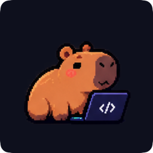
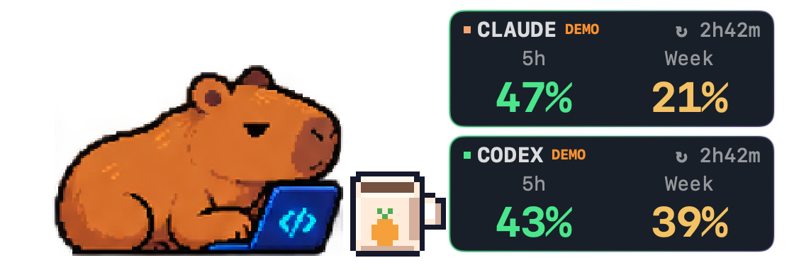
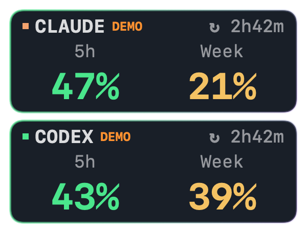
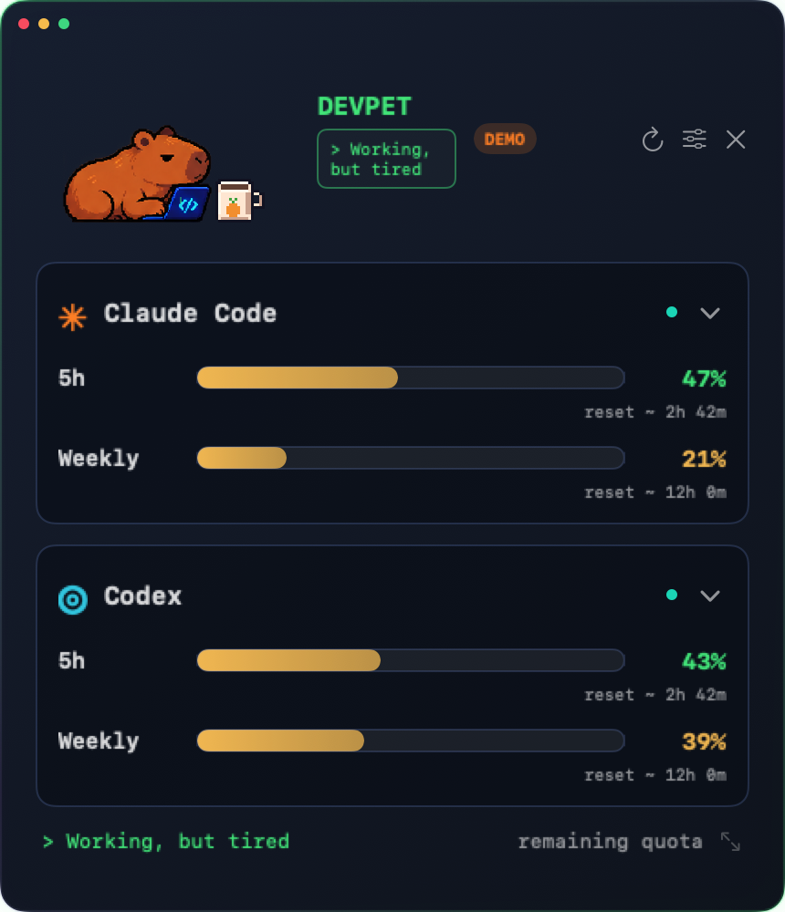
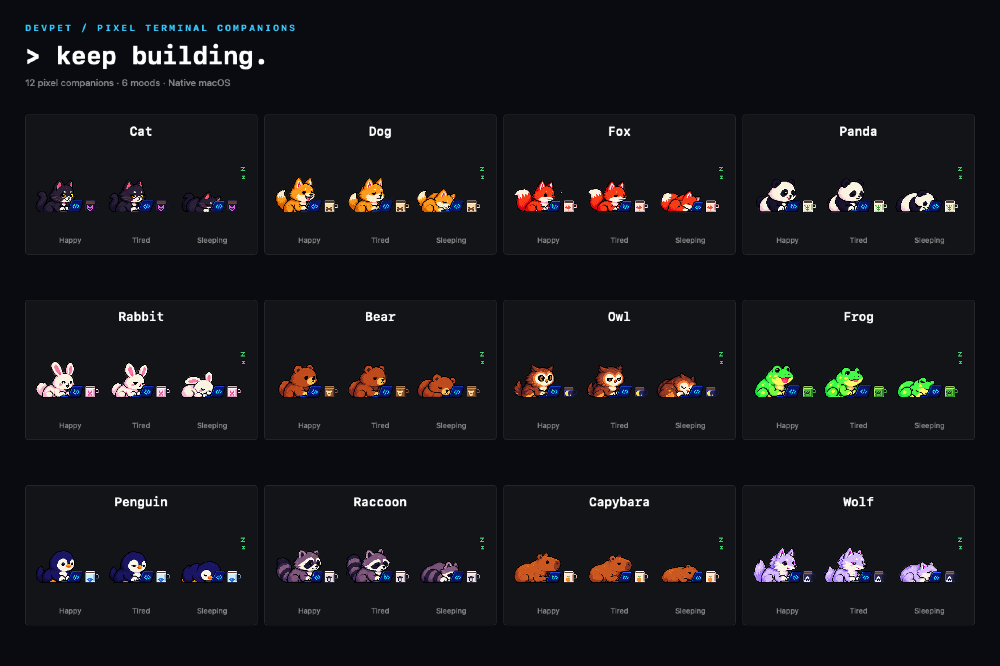

<div align="center">
  
  <h1>DevPet — Claude Code &amp; Codex Usage Monitor for macOS</h1>
  <p>Keep your AI coding limits in sight. Keep a pixel friend by your side.</p>
  <p>
    <a href="https://github.com/emreeylm/devpet-macos/releases/latest">Download for Mac</a> ·
    <a href="#quick-start">Quick start</a> ·
    <a href="Docs/INTEGRATIONS.md">Connect providers</a> ·
    <a href="README.tr.md">Türkçe</a>
  </p>
  <p>
    <a href="https://github.com/emreeylm/devpet-macos/releases"></a>
    <a href="https://github.com/emreeylm/devpet-macos/actions/workflows/ci.yml"></a>
    
    
    <a href="LICENSE"></a>
  </p>
</div>

**DevPet is a native macOS menu bar app and floating desktop widget for tracking Claude Code and OpenAI Codex usage limits.** See remaining five-hour and weekly quotas, know when your next reset is due, and choose between a small limits-only panel, a pixel pet, or a detailed dashboard.

<p align="center">
  
</p>

All screenshots show **demo data**, not a real account.

## Why DevPet?

A coding session should not end with a surprise usage limit. DevPet puts your **Claude Code usage** and **Codex rate limits** on your desktop so you can check your remaining allowance without interrupting your work.

- **Two providers, one view.** Show Claude Code, Codex, or both. Toggle five-hour and weekly quota windows independently.
- **Reset countdowns.** See when the five-hour limit renews, with the exact reset timestamp in a tooltip when the provider supplies it.
- **Three display modes.** Minimal for just the numbers, Pet Only for a companion with quota cards, Expanded for a resizable usage dashboard.
- **Always on top.** Drag the widget anywhere, recover its position from the menu bar, and use it across displays. Eligible full-screen spaces follow macOS window rules.
- **Twelve pixel pets.** Each has its own mug and working, tired and sleeping illustrations. The pet's keyboard typing responds to the remaining five-hour quota.
- **Make it fit.** Eight color themes, a custom accent, light/dark appearances, transparent backgrounds, 50–250% size and adjustable opacity. Text renders at the current display density.
- **Native and local.** Built with SwiftUI and AppKit, with no third-party runtime packages or DevPet cloud account.
- **Daily conveniences.** English/Turkish interface, optional launch at login, low-limit notifications, manual refresh and a clearly labeled demo mode.

## Pick your view

| Mode | What you see | Best for |
| --- | --- | --- |
| **Minimal** | Small Claude Code / Codex quota cards, no mascot | Keeping limits visible with little desktop space |
| **Pet Only** | A pixel pet, its mug and the selected quota cards | A quiet desktop companion while you code |
| **Expanded** | A resizable dashboard with independent provider sections | Reading usage and reset information in detail |

Switch modes in **Settings → Widget → Display mode**, from the menu bar, or by right-clicking the small widget. Minimal can be dragged from anywhere; the Expanded dashboard has a draggable header.

<details>
<summary><strong>Preview Minimal and Expanded</strong></summary>

<p align="center">
  
</p>
<p align="center">
  
</p>

</details>

## Quick start

**Requirements:** macOS 14 Sonoma or later. The universal app supports Apple Silicon and Intel Macs. Provider usage requires a supported signed-in Claude Code or Codex session; no subscription is needed to try demo mode.

1. Download **DevPet.dmg** from [the latest release](https://github.com/emreeylm/devpet-macos/releases/latest).
2. Open the DMG, drag **DevPet.app** into **Applications**, and launch it.
3. Open **Settings → Providers** and connect the provider you use, or enable **Demo mode** to explore the app first.
4. Pick **Minimal**, **Pet Only**, or **Expanded** in **Settings → Widget**.

**Signing status:** current downloadable builds are ad-hoc signed and **not Apple-notarized**. macOS may display a security warning. Build from source if you prefer; do not disable Gatekeeper. Signing details are in the [release guide](Docs/RELEASING.md).

### Connect Codex

Sign in to the Codex CLI with `codex login` using your ChatGPT account. DevPet finds common installation paths, including the CLI bundled with Codex.app, or accepts a custom executable path in Settings. It reads available quota windows through the local app-server protocol, using the CLI's existing authentication. It does not start a model turn or read token files.

API-key accounts and unsupported CLI versions may not expose subscription limits. See the [Codex setup and troubleshooting guide](Docs/INTEGRATIONS.md#codex-supported-local-app-server-protocol).

### Connect Claude Code

DevPet reads Claude Code's local **statusline usage data**. In **Settings → Providers**, copy the displayed `statusLine` configuration and manually merge it into your Claude settings. DevPet never edits those settings for you.

Claude observations arrive from active sessions. If Claude is idle, DevPet cannot independently fetch a fresh quota; old data is marked unavailable rather than shown as live. Follow the [Claude Code setup guide](Docs/INTEGRATIONS.md#claude-code-official-local-statusline-bridge), including the wrapper option if you already use a statusline.

## Meet the companions

Cat · Dog · Fox · Panda · Rabbit · Bear · Owl · Frog · Penguin · Raccoon · Capybara · Wolf

<p align="center">
  
</p>

The lowest fresh **five-hour remaining quota** among enabled providers sets the pet's activity:

| Remaining five-hour quota | Pet state |
| --- | --- |
| Above 50% | Happy, faster typing |
| 15–50% | Tired, slower typing |
| Below 15% | Sleeping, no typing |
| Unavailable or stale | Unknown; no invented percentage |

Weekly limits remain visible but do not control animation. The body, laptop and decorative cup stay still; there is no drinking animation. Reduce Motion and the animation toggle are respected. Pixel artwork is bundled with the app, was generated for this project, and is not downloaded during use.

## Privacy

There is **no analytics SDK, no DevPet account and no DevPet-owned server**. Preferences stay on your Mac. DevPet does not collect your prompts, code, conversations, credentials or transcripts. The Claude bridge saves only sanitized quota percentages and timestamps; Codex manages its own authentication and network requests.

Read the [privacy policy](PRIVACY.md) and [provider data semantics](Docs/INTEGRATIONS.md) for details.

## Build from source

Use a Mac with a recent Xcode, its command-line tools and Python 3 for project generation. The deployment target is macOS 14; automated builds use a macOS 26 runner.

```sh
git clone https://github.com/emreeylm/devpet-macos.git
cd devpet-macos
swift test
Scripts/build.sh
open dist/DevPet.app
```

Or open `DevPet.xcodeproj`, choose **DevPet → My Mac**, and run it. When adding Swift files, regenerate the project with `python3 Scripts/generate-project.py`.

```sh
Scripts/dmg.sh       # Package dist/DevPet.dmg
Scripts/validate.sh  # Verify signature, bundle and DMG integrity
```

See [architecture](Docs/ARCHITECTURE.md), [contributing](CONTRIBUTING.md) and [release instructions](Docs/RELEASING.md). Tests cover quota parsing, five-hour activity rules, persistence, reset semantics, provider subprocess behavior and native window interactions.

## Frequently asked questions

### Is this a macOS widget or a menu bar app?

Both a menu bar app and a floating desktop window. DevPet is not a WidgetKit/Notification Center widget. It can stay visible over your editor and can also run in a mascot-free Minimal mode.

### Does DevPet increase or reset Claude Code / Codex limits?

No. It displays the limits and reset information supplied by the providers. It cannot change your allowance, billing or plan.

### Why does Claude Code show no data?

The statusline bridge must be configured, and a supported active Claude session must supply quota fields. Missing, expired and stale observations are shown as unavailable. Check the [connection guide](Docs/INTEGRATIONS.md).

### Does it work on 24-inch and 32-inch displays?

Window size and rendering follow macOS display scale, not the monitor's diagonal. Text is drawn at the active density; pixel pets keep sharp pixel edges. Perceived sharpness still depends on screen resolution and pixel density. Intel and full-screen/multi-display hardware combinations have not all been physically tested.

## Contributing and support

Found a bug or have a feature idea? [Open an issue](https://github.com/emreeylm/devpet-macos/issues) with your macOS version, display mode and reproduction steps. Do not include authentication tokens, transcripts or private account data. Pull requests are welcome; start with the [contributing guide](CONTRIBUTING.md).

Maintained by [Yunus Emre Yılmaz](https://github.com/emreeylm). Released under the [MIT License](LICENSE).

DevPet is an independent project and is not affiliated with or endorsed by Anthropic or OpenAI. Claude Code and Codex are referenced to describe the supported integrations.
